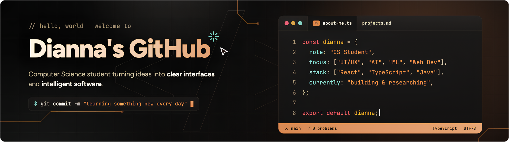
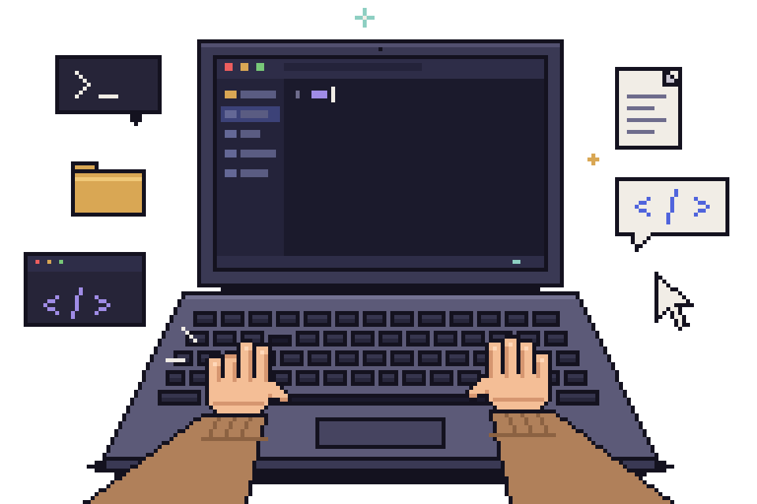
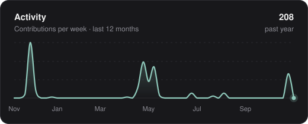
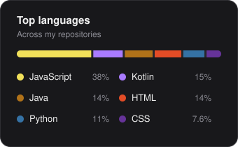
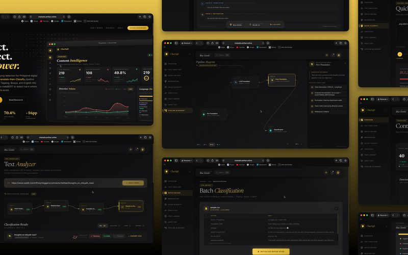
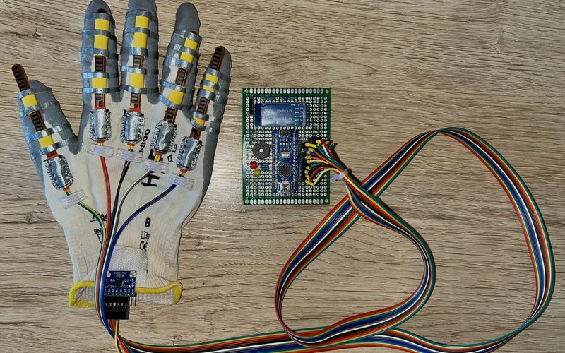
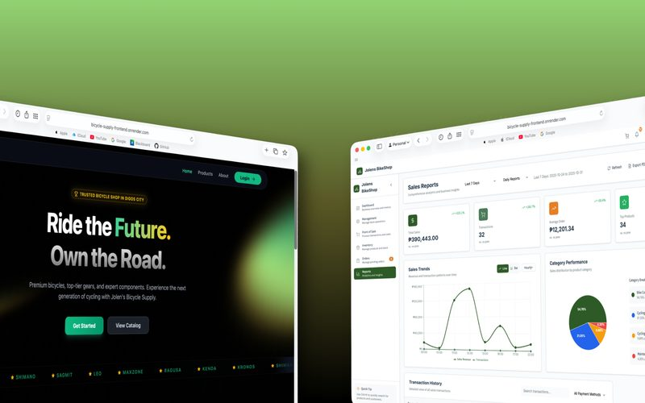
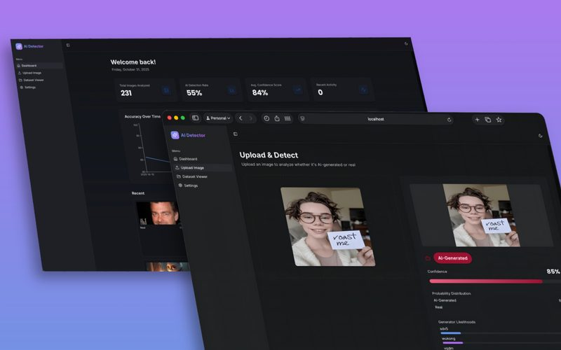

<a href="https://dcmcamihan.github.io/e-portfolio/">
  <picture>
    <source media="(prefers-color-scheme: dark)" srcset="./assets/banner-dark.png">
    <source media="(prefers-color-scheme: light)" srcset="./assets/banner-light.png">
    
  </picture>
</a>

## About me

`> whoami`

Hi, I'm **Dianna Claire Marie Amihan**, a Computer Science student at Mapúa Malayan Colleges Mindanao in Davao City, Philippines.

I build web applications and work on AI and machine learning projects. I enjoy the whole process, from understanding the problem and planning a solution to building and testing it. I also care about how things look and feel, so a lot of my work starts in Figma.

I like turning ideas into something that actually *runs*.

 

- **Focus:** web development, AI and machine learning, UI/UX design
- **Research:** cyberbullying, sign language, and AI image detection
- **Based in:** Davao City, Philippines
- **Open to:** web development and AI/ML opportunities

 

## Toolbox

`> ls ~/tools`

**Languages** 

**Web and backend** 

**AI and machine learning** 

**Design and tools** 

 

## GitHub stats

`> git log --since="1 year ago"`

<picture>
  <source media="(prefers-color-scheme: dark)" srcset="./assets/stats/activity-dark.svg">
  <source media="(prefers-color-scheme: light)" srcset="./assets/stats/activity-light.svg">
  
</picture>
<picture>
  <source media="(prefers-color-scheme: dark)" srcset="./assets/stats/languages-dark.svg">
  <source media="(prefers-color-scheme: light)" srcset="./assets/stats/languages-light.svg">
  
</picture>

 

## Featured projects

`> ls ~/projects --featured`

<table>
  <tr>
    <td width="50%" valign="top">
      
      <h3>ChatSafe</h3>
      <b>LEAD</b> · AI/ML · NLP
      
Cyberbullying detection for code-mixed Tagalog, Bisaya, and English text. It translates the mixed text into English first, then classifies it with HateBERT, since there is little Filipino training data to work with.

      
<code>70.4% Tier 3 macro-F1</code> <code>+16pp from translation</code>

      Python · Gemini API · HateBERT · React · Node.js · MySQL 
      🔒 Private repo · <a href="https://dcmcamihan.github.io/e-portfolio/#projects">details on my portfolio</a>
    </td>
    <td width="50%" valign="top">
      
      <h3>SeGlo-12</h3>
      <b>LEAD</b> · AI/ML · Computer Vision · Embedded
      
A Philippine sign language translator with two modes. A flex-sensor smart glove and a camera mode using MediaPipe hand tracking both turn gestures into speech and text in real time.

      
<code>87% vision accuracy</code> <code>4.51/5 beta satisfaction</code>

      Arduino · C++ · MediaPipe · TensorFlow Lite · Python 
      <a href="https://github.com/dcmcamihan/seglo12">View repository →</a>
    </td>
  </tr>
  <tr>
    <td width="50%" valign="top">
      
      <h3>Jolen's Bicycle Supply</h3>
      <b>CONTRIBUTOR</b> · Full-stack · Web
      
A point-of-sale and inventory system for a bicycle shop in Digos City that was still using paper logs. It handles sales, live stock tracking, and daily reports. I worked on the frontend and the database.

      React · Vite · Tailwind CSS · Node.js · Express · MySQL 
      <a href="https://github.com/dcmcamihan/bicycle-supply-frontend">Frontend</a> · <a href="https://github.com/dcmcamihan/bicycle-supply-backend">Backend</a>
    </td>
    <td width="50%" valign="top">
      
      <h3>AI Image Detection</h3>
      <b>LEAD</b> · AI/ML · Computer Vision · Forensics
      
Tells real photos apart from AI-generated ones using a fine-tuned Swin Transformer. Grad-CAM heatmaps show which parts of the image led to the decision.

      
<code>7 AI platforms covered</code>

      Python · PyTorch · Swin Transformer · Grad-CAM 
      <a href="https://github.com/dcmcamihan/ai-image-detector">View repository →</a>
    </td>
  </tr>
</table>

 

  <picture>
    <source media="(prefers-color-scheme: dark)" srcset="./assets/coding-girl-dark.gif">
    <source media="(prefers-color-scheme: light)" srcset="./assets/coding-girl-light.gif">
    
  </picture>

---

  Thanks for stopping by. See more on my <a href="https://dcmcamihan.github.io/e-portfolio/">portfolio</a>, or say hi at <a href="mailto:diannaclairemarie.amihan@gmail.com">diannaclairemarie.amihan@gmail.com</a>.

