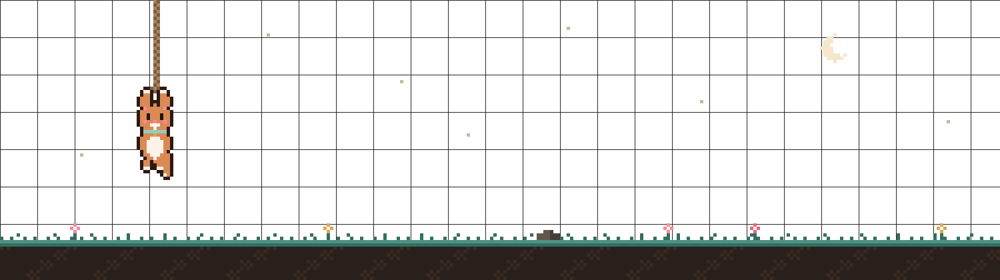

<a href="https://dcmcamihan.github.io/e-portfolio/">
  <picture>
    <source media="(prefers-color-scheme: dark)" srcset="./assets/banner-dark.png">
    <source media="(prefers-color-scheme: light)" srcset="./assets/banner-light.png">
    
  </picture>
</a>

## About me

`> whoami`

Hi, I'm **Dianna Claire Marie Amihan**, a Computer Science student at Mapúa Malayan Colleges Mindanao in Davao City, Philippines.

I build web applications and work on AI and machine learning projects. I enjoy the whole process, from understanding the problem and planning a solution to building and testing it. I also care about how things look and feel, so a lot of my work starts in Figma.

I like turning ideas into something that actually *runs*.

 

 

**Focus areas** 
<picture><source media="(prefers-color-scheme: light)" srcset="./assets/focus/web-light.svg"></picture>
<picture><source media="(prefers-color-scheme: light)" srcset="./assets/focus/uiux-light.svg"></picture> 
<picture><source media="(prefers-color-scheme: light)" srcset="./assets/focus/ai-light.svg"></picture>
<picture><source media="(prefers-color-scheme: light)" srcset="./assets/focus/ml-light.svg"></picture>

**Find me on** 
<a href="https://dcmcamihan.github.io/e-portfolio/"><picture><source media="(prefers-color-scheme: light)" srcset="./assets/contact/portfolio-light.svg"></picture></a>
<a href="https://www.linkedin.com/in/dianna-claire-marie-amihan-29ab23293"><picture><source media="(prefers-color-scheme: light)" srcset="./assets/contact/linkedin-light.svg"></picture></a>
<a href="mailto:diannaclairemarie.amihan@gmail.com"><picture><source media="(prefers-color-scheme: light)" srcset="./assets/contact/email-light.svg"></picture></a>
<a href="https://www.credly.com/users/dianna-claire-marie-amihan"><picture><source media="(prefers-color-scheme: light)" srcset="./assets/contact/credly-light.svg"></picture></a>

 

 

## Toolbox

`> ls ~/tools`

**Languages** 
<a href="https://docs.oracle.com/en/java/" title="Java"><picture><source media="(prefers-color-scheme: light)" srcset="./assets/icons/openjdk-light.svg"></picture></a>
<a href="https://docs.python.org/3/" title="Python"><picture><source media="(prefers-color-scheme: light)" srcset="./assets/icons/python-light.svg"></picture></a>
<a href="https://developer.mozilla.org/en-US/docs/Web/JavaScript" title="JavaScript"><picture><source media="(prefers-color-scheme: light)" srcset="./assets/icons/javascript-light.svg"></picture></a>
<a href="https://www.typescriptlang.org/docs/" title="TypeScript"><picture><source media="(prefers-color-scheme: light)" srcset="./assets/icons/typescript-light.svg"></picture></a>
<a href="https://kotlinlang.org/docs/home.html" title="Kotlin"><picture><source media="(prefers-color-scheme: light)" srcset="./assets/icons/kotlin-light.svg"></picture></a>
<a href="https://learn.microsoft.com/en-us/dotnet/csharp/" title="C#"><picture><source media="(prefers-color-scheme: light)" srcset="./assets/icons/csharp-light.svg"></picture></a>
<a href="https://isocpp.org/" title="C++"><picture><source media="(prefers-color-scheme: light)" srcset="./assets/icons/cpp-light.svg"></picture></a>
<a href="https://developer.mozilla.org/en-US/docs/Web/HTML" title="HTML"><picture><source media="(prefers-color-scheme: light)" srcset="./assets/icons/html-light.svg"></picture></a>
<a href="https://developer.mozilla.org/en-US/docs/Web/CSS" title="CSS"><picture><source media="(prefers-color-scheme: light)" srcset="./assets/icons/css-light.svg"></picture></a>

**Web and backend** 
<a href="https://react.dev/" title="React"><picture><source media="(prefers-color-scheme: light)" srcset="./assets/icons/react-light.svg"></picture></a>
<a href="https://vite.dev/guide/" title="Vite"><picture><source media="(prefers-color-scheme: light)" srcset="./assets/icons/vite-light.svg"></picture></a>
<a href="https://tailwindcss.com/docs" title="Tailwind CSS"><picture><source media="(prefers-color-scheme: light)" srcset="./assets/icons/tailwindcss-light.svg"></picture></a>
<a href="https://nodejs.org/en/docs" title="Node.js"><picture><source media="(prefers-color-scheme: light)" srcset="./assets/icons/nodejs-light.svg"></picture></a>
<a href="https://expressjs.com/" title="Express"><picture><source media="(prefers-color-scheme: light)" srcset="./assets/icons/express-light.svg"></picture></a>
<a href="https://fastapi.tiangolo.com/" title="FastAPI"><picture><source media="(prefers-color-scheme: light)" srcset="./assets/icons/fastapi-light.svg"></picture></a>
<a href="https://dev.mysql.com/doc/" title="MySQL"><picture><source media="(prefers-color-scheme: light)" srcset="./assets/icons/mysql-light.svg"></picture></a>

**AI and machine learning** 
<a href="https://pytorch.org/" title="PyTorch"><picture><source media="(prefers-color-scheme: light)" srcset="./assets/icons/pytorch-light.svg"></picture></a>
<a href="https://www.tensorflow.org/lite" title="TensorFlow Lite"><picture><source media="(prefers-color-scheme: light)" srcset="./assets/icons/tensorflow-light.svg"></picture></a>
<a href="https://developers.google.com/mediapipe" title="MediaPipe"><picture><source media="(prefers-color-scheme: light)" srcset="./assets/icons/mediapipe-light.svg"></picture></a>
<a href="https://huggingface.co/" title="Hugging Face"><picture><source media="(prefers-color-scheme: light)" srcset="./assets/icons/huggingface-light.svg"></picture></a>
<a href="https://ai.google.dev/" title="Gemini API"><picture><source media="(prefers-color-scheme: light)" srcset="./assets/icons/gemini-light.svg"></picture></a>

**Design and tools** 
<a href="https://help.figma.com/" title="Figma"><picture><source media="(prefers-color-scheme: light)" srcset="./assets/icons/figma-light.svg"></picture></a>
<a href="https://www.canva.com/help/" title="Canva"><picture><source media="(prefers-color-scheme: light)" srcset="./assets/icons/canva-light.svg"></picture></a>
<a href="https://git-scm.com/doc" title="Git"><picture><source media="(prefers-color-scheme: light)" srcset="./assets/icons/git-light.svg"></picture></a>
<a href="https://docs.arduino.cc/" title="Arduino"><picture><source media="(prefers-color-scheme: light)" srcset="./assets/icons/arduino-light.svg"></picture></a>

 

## GitHub stats

`> git log --since="1 year ago"`

<picture>
  <source media="(prefers-color-scheme: dark)" srcset="./assets/stats/activity-dark.svg">
  <source media="(prefers-color-scheme: light)" srcset="./assets/stats/activity-light.svg">
  
</picture>
<picture>
  <source media="(prefers-color-scheme: dark)" srcset="./assets/stats/languages-dark.svg">
  <source media="(prefers-color-scheme: light)" srcset="./assets/stats/languages-light.svg">
  
</picture>

 
 

<picture>
  <source media="(prefers-color-scheme: dark)" srcset="./assets/pixel-pet-dark.gif">
  <source media="(prefers-color-scheme: light)" srcset="./assets/pixel-pet-light.gif">
  
</picture>

---

  Thanks for stopping by. See more on my <a href="https://dcmcamihan.github.io/e-portfolio/">portfolio</a>, or say hi at <a href="mailto:diannaclairemarie.amihan@gmail.com">diannaclairemarie.amihan@gmail.com</a>.

